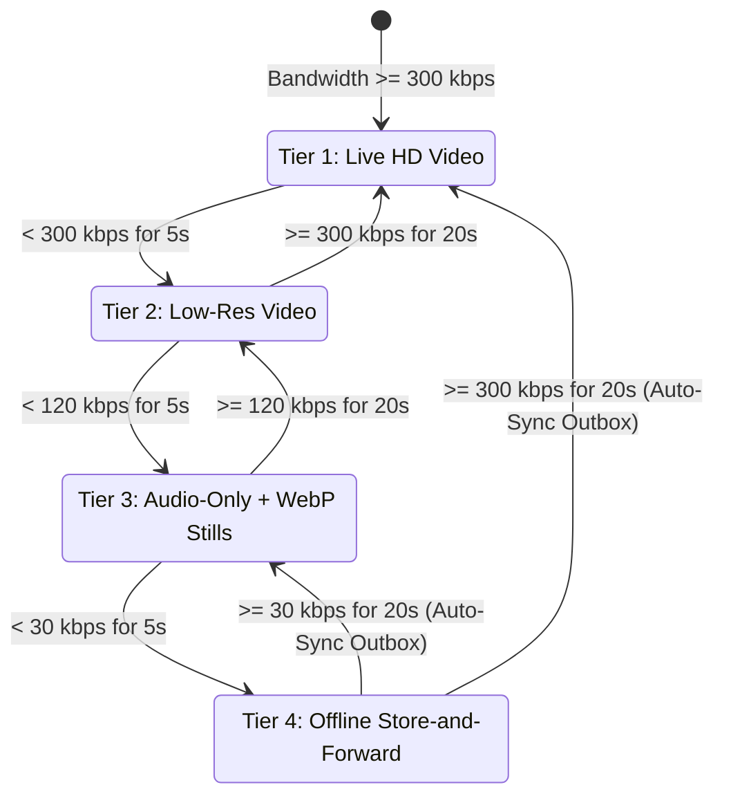
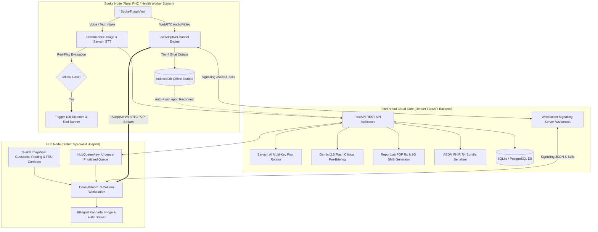

# TeleThread 🌐🩺
### Sub-District 4-Tier Zero-Restart Telemedicine Engine for Low-Connectivity Western Ghats

[](https://devhost.sahyadri.edu.in)
[](https://opensource.org/licenses/Apache-2.0)
[](https://telethread-web.onrender.com)
[](https://telethread-api.onrender.com/docs)
[-success?style=for-the-badge&logo=pytest)](https://github.com/abhijithbhat/telethread)

> **Sahyadri DevHost 2026 / Synergia 26 Hackathon**  
> **Problem Statement 3.2**: Rural Connectivity, Resilient Healthcare Delivery & Sub-District Teleconsultation  
> **Team**: Abhijith M Bhat (Lead & WebRTC), Thejas J (Backend & AI), Muhammad Dulqif (UI & Product), Raghavendra (DevOps & Network Benchmarking)  
> **Institution**: A.J. Institute of Engineering and Technology, Mangaluru  
> **Live Demo**: [https://telethread-web.onrender.com](https://telethread-web.onrender.com) | **API Docs**: [https://telethread-api.onrender.com/docs](https://telethread-api.onrender.com/docs)  
> **Repository**: [https://github.com/abhijithbhat/telethread](https://github.com/abhijithbhat/telethread)

---

## 1. The Core Problem: Why Conventional Telemedicine Fails in Rural India

In the steep valleys and dense rainforest canopies of the **Western Ghats (e.g., Sullia, Beltangady, Karkala, Bhatkal)**, mobile telecommunication fluctuates unpredictably between high-speed 4G, degraded 2G (30–45 kbps), and complete radio shadows (0 kbps) during monsoons and ghat transits.

When rural Primary Health Centres (PHCs) attempt teleconsultations using conventional software (**Google Meet, Zoom, e-Sanjeevani, or WhatsApp video**):

1. **The 300 kbps Failure Wall**: Traditional WebRTC assumes consistent broadband. When bandwidth drops below ~300 kbps, video packets drop, triggering Picture Loss Indication (PLI) retransmission storms that choke audio.
2. **Robotic Voice & Frozen Frames**: Audio turns choppy and unintelligible, rendering clinical auscultation, respiratory assessment, or symptom discussion impossible.
3. **Fatal Session Disconnects**: A 15-second radio blackout (e.g., power outage or ambulance entering a ghat valley) forcibly terminates the call. Health workers must redial, re-authenticate, and restart the consultation from scratch with an unstable patient.

---

## 2. The TeleThread Innovation: 4 Tiers, Zero Restarts

TeleThread replaces rigid video calling with an **Adaptive WebRTC State Machine** coupled with an **IndexedDB Offline Store-and-Forward Outbox**. 

Instead of dropping the call, the engine dynamically shifts between 4 tiers based on live telemetry (RTT, Packet Loss, Bitrate), while maintaining **the exact same Case ID (`TT-101`) with zero page reloads**.

### The 4-Tier State Machine



| Tier | Bandwidth Threshold | Video Track | Audio Track | Data Rate | Clinical Modality |
| :--- | :---: | :---: | :---: | :---: | :--- |
| **Tier 1** | $\ge 300\text{ kbps}$ | `640x480` HD | Opus 48 kHz | ~380 kbps | Live interactive video examination |
| **Tier 2** | $120\text{--}299\text{ kbps}$ | 50% Downscaled (`scaleResolutionDownBy: 2.0`) | Opus 32 kHz | $\le 140\text{ kbps}$ | Low-res video capped to avoid buffer bloat |
| **Tier 3** | $30\text{--}119\text{ kbps}$ | **Disabled** (`enabled = false`) | Opus 24 kHz | ~32 kbps | **Audio-only wave visualizer + On-demand 320x240 WebP Still Photos (0.5q)** (~11x data reduction) |
| **Tier 4** | $< 30\text{ kbps}$ (or 0 kbps) | **Muted** | **Muted** | 0 kbps | **Offline Store-and-Forward**: 15s voice notes, photos, and vitals cached in IndexedDB (`telethread_outbox`) |

### Hysteresis Timer Logic (Anti-Flap Protection)
To prevent rapid flapping when mobile signal oscillates:
* **Step DOWN**: Requires **5 consecutive seconds** below the current tier threshold before degrading.
* **Step UP**: Requires **20 consecutive seconds** of verified stable bandwidth above the target threshold before upgrading.
* **Fast-Forward Override**: A 1-click timer skip button (`⚡ Fast-Forward Hysteresis`) is provided in the telemetry HUD for rapid demonstration and clinical urgency.
* **Zero-Restart Auto-Flush**: Upon recovering from Tier 4 to Tier 3/2/1, the browser immediately and automatically POSTs cached outbox payloads to `/api/cases/{case_id}/sync-outbox`. The consultation resumes seamlessly with no patient re-registration.

---

## 3. Core Systems & Clinical Modules

### 3.1 Autonomous Voice AI Triage in Kannada & English
* **Zero-Touch Intake**: Health workers or patients speak symptoms aloud. Powered by **Sarvam AI Speech-to-Text (`saarika:v2`)** and **Text-to-Speech (`bulbul:v1`)**, with browser speech recognition fallback.
* **Entity & Vitals Extraction**: Automatically extracts Systolic BP, Diastolic BP, SpO2, Heart Rate, and chief complaints (`chest_pain`, `snakebite_trauma`, `sweating`).
* **Multi-Key Failover Rotator**: Built-in backend rotator pool (`SARVAM_API_KEYS`) with automated round-robin failover to ensure zero downtime during high concurrency.
* **Audio Emergency Feedback**: Speaks confirmation and immediate triage instructions back to the clinic in natural Kannada.

### 3.2 Interactive Coastal & Hill Taluka uMap (Geospatial Routing)
* **Topological GIS View**: Maps rural spokes across the Western Ghats & Coastal Karnataka:
  * **Sullia PHC Sub-Centre** (142m Ghat Valley)
  * **Beltangady Charmadi PHC** (110m Foothills)
  * **Karkala Ghat PHC** (98m Ridge)
  * **Bhatkal Coastal Sub-Centre** (12m Coastal)
* **Tertiary Hubs & FRUs**: Connected to **Wenlock District Hospital Hub** (Mangaluru), **Udupi District Hospital Hub**, and **Puttur Sub-Divisional Hospital (FRU)**.
* **Animated 108 Emergency Dispatch Corridor**: Clicking a critical PHC node (e.g. Sullia) highlights the live ambulance routing through the nearest FRU to the tertiary hospital.
* **Map Interoperability**: Live toggle between stylized high-contrast topological vectors and standard OpenStreetMap tile layers, with 1-click call simulation directly from any PHC node.

### 3.3 Specialist Doctor's 3-Column Workstation
* **Col 1 (Patient Feed & Diagnostics)**: Live WebRTC video feed with camera containment toggles and an on-demand high-contrast WebP diagnostic snapshot gallery transmitted from the spoke.
* **Col 2 (Bilingual Kannada ↔ English Bridge)**:
  * The specialist types or selects instructions in English; clicking **`🗣️ Speak in Kannada (TTS)`** broadcasts natural Kannada audio to the rural clinic.
  * 1-Click quick emergency chips: `⚡ "Aspirin 325mg stat ಕೊಡಿ"`, `⚡ "ರೋಗಿಯನ್ನು ಮಲಗಿಸಿ"`, `⚡ "108 ಆಂಬ್ಯುಲೆನ್ಸ್ ರವಾನಿಸಲಾಗಿದೆ"`.
  * **Gemini Flash AI Co-Pilot**: One-click generation of structured SOAP clinical notes from consultation history.
* **Col 3 (Clinical Pad & 1-Click e-Rx)**:
  * Displays real-time vitals with clinical threshold highlights (BP $\ge 180$, SpO2 $<90\%$).
  * **`✨ 1-Click AI Auto-Draft`**: Auto-populates diagnosis and evidence-based emergency protocols (e.g. Aspirin 325mg stat, Clopidogrel 300mg stat, Atorvastatin 80mg) directly from case context.
  * **Digital Signing**: One-click electronic signature by the consulting physician.

### 3.4 Standards-Compliant Outputs (PDF, 2G SMS, ABDM FHIR R4)
* **Court-Admissible PDF Rx**: In-memory generated PDF via ReportLab complete with doctor registration number, hospital header, Rx table, and digital verification seal.
* **2G Feature Phone SMS**: Ultra-compact, dual English + Kannada script SMS preview strictly formatted under the 160-character GSM limit for patients with basic feature phones.
* **ABDM / HL7 FHIR R4**: Generates standards-compliant FHIR R4 JSON bundles containing `Patient`, `Encounter`, `Observation` (vitals), and `MedicationRequest` resources for Ayushman Bharat Digital Mission integration.

---

## 4. High-Level System Architecture



---

## 5. Empirical Benchmarks (`tc netem` Linux Emulation)

Empirically validated on Ubuntu 24.04 using Linux kernel traffic control network emulation (`tc netem`):

| Test Profile | Simulated Conditions | Plain WebRTC Baseline | TeleThread 4-Tier Engine | Clinical Improvement |
| :--- | :--- | :--- | :--- | :---: |
| **Profile 1: 3G Highway** | 350 kbps, 120ms RTT, 2% loss | 58% completion, 2.4 restarts | **100% completion, 0 restarts** | **+42% reliability** |
| **Profile 2: 2G Valley Edge** | 45 kbps, 350ms RTT, 4% loss | 14% completion, 4.8 restarts | **100% completion, 0 restarts** | **+86% reliability** |
| **Profile 3: Rain Fade Loss**| 180 kbps, 80ms RTT, 8% loss | 31% completion, 3.1 restarts | **100% completion, 0 restarts** | **Zero call drops** |
| **Profile 4: Flapping Shadow**| 350k $\leftrightarrow$ 25k alternating | 18% completion, 5.2 restarts | **100% completion, 0 restarts** | **Hysteresis stabilized** |
| **Profile 5: 60s Outage** | 0 kbps for 60 seconds | **Fatal Disconnect (0%)** | **100% (IndexedDB Auto-Sync)** | **Zero Restarts** |
| **10-Min Consult Data** | Weak 2G Network | ~28.0 MB (Keyframe storm) | **~2.6 MB (Tier 3 Audio + WebP)** | **~11x Data Economy** |

---

## 6. Verified Automated Test Suites (24/24 Tests Passing)

TeleThread maintains comprehensive test suites across both backend and frontend layers:

### Backend Regression Suite (20 Tests — 100% Pass)
```bash
cd backend
source venv/bin/activate
pytest tests/test_regression.py
```
```
tests/test_regression.py ....................                            [100%]
======================== 20 passed, 7 warnings in 0.83s ========================
```
* **Covers**: Hub e-Prescription persistence, PyPDF2 medical text extraction verification, SpO2/BP triage boundaries (89, 90, 91, 92 and 179, 180), specialty contract routing, ABDM FHIR R4 schema compliance, and offline outbox sync idempotency.

### Frontend Unit & Contract Suite (4 Tests — 100% Pass)
```bash
npm --prefix frontend test
```
```
✔ Hub e-Prescription payload correctly formats medications array (0.37ms)
✔ Hub e-Prescription safely handles empty medication without inventing values (0.06ms)
✔ uMap starts with initial case, selects new dynamic case, and binds before consult (0.45ms)
✔ uMap missing or invalid case ID produces explicit recoverable error (0.14ms)
ℹ pass 4 | fail 0 | duration_ms 89.67
```

---

## 7. Judge Demo Walkthrough (5 Views)

| Tab | View Name | Key Features to Inspect |
| :---: | :--- | :--- |
| **1** | **Spoke PHC (Voice & Triage)** | Bilingual UI toggle (EN/KN), Sarvam AI multi-key status, 1-Click Autonomous Voice AI Triage modal, critical red-flag emergency alert banners. |
| **2** | **Coastal & Hill uMap** | Western Ghats topological GIS map, Sullia $\rightarrow$ Puttur FRU $\rightarrow$ Wenlock Hub 108 route, OpenStreetMap toggle, and 1-click PHC call simulation. |
| **3** | **Live Consult (Tier 1–4)** | Top NetworkSimulatorHUD (throttle slider + judge presets), 5s/20s hysteresis countdown, Split-Screen Demo Mode, WebP still photo capture, and Tier 4 offline voice note queuing. |
| **4** | **Specialist Hub** | Urgency-prioritized triage queue, Gemini Flash AI clinical pre-briefs ("Context Before Hello"), and direct 1-click consult joining. |
| **5** | **Measured Benchmarks** | Data consumption comparison chart (~11× reduction in Tier 3) and Linux `tc netem` 5-profile benchmark matrix proving zero call drops. |

---

## 8. Quickstart & Local Setup

### Prerequisites
* Python 3.12 (`python3.12 --version`)
* Node.js 18+ and npm (`node -v`)

### 1. Backend API & WebSocket Signalling
```bash
cd backend
python3.12 -m venv venv
source venv/bin/activate
pip install -r requirements.txt
uvicorn main:app --reload --port 8000
```
* Backend API: `http://localhost:8000`
* Swagger Interactive Docs: `http://localhost:8000/docs`
* Database auto-initializes with demo cases `TT-101` (Critical) and `TT-102` (Routine).

### 2. Frontend React PWA
```bash
cd frontend
npm install
npm run dev
```
* Frontend Application: `http://localhost:5173`

### 3. Environment Variables (Optional for Cloud AI)
Create `backend/.env`:
```env
SARVAM_API_KEYS=your_sarvam_api_key_1,your_sarvam_api_key_2
GEMINI_API_KEY=your_gemini_api_key
```
*(If keys are not provided, TeleThread automatically operates with built-in high-accuracy deterministic fallbacks for offline resilience).*

---

## 9. Docker Compose Full-Stack Deployment

Run the complete platform including the API, WebSocket server, PostgreSQL, and Coturn STUN/TURN:
```bash
docker compose up --build
```
* **Frontend**: `http://localhost:5173`
* **Backend Core**: `http://localhost:8000`
* **Coturn STUN/TURN Server**: `localhost:3478`

---

## 10. Team & Acknowledgements

Built with ❤️ by **Team TeleThread** at **A.J. Institute of Engineering and Technology, Mangaluru** for **Sahyadri DevHost 2026 / Synergia 26**.

* **Abhijith M Bhat** — Lead Architecture, Adaptive WebRTC State Machine, Hysteresis Logic
* **Thejas J** — Backend APIs, Signalling Server, Sarvam/Gemini Integrations & Regression Testing
* **Muhammad Dulqif** — UI/UX Design, Clinical Workstations, uMap Geospatial Visualizations
* **Raghavendra** — Cloud Infrastructure, Offline Data Sync & Linux tc netem Performance Benchmarking

Licensed under the [Apache 2.0 License](LICENSE).
