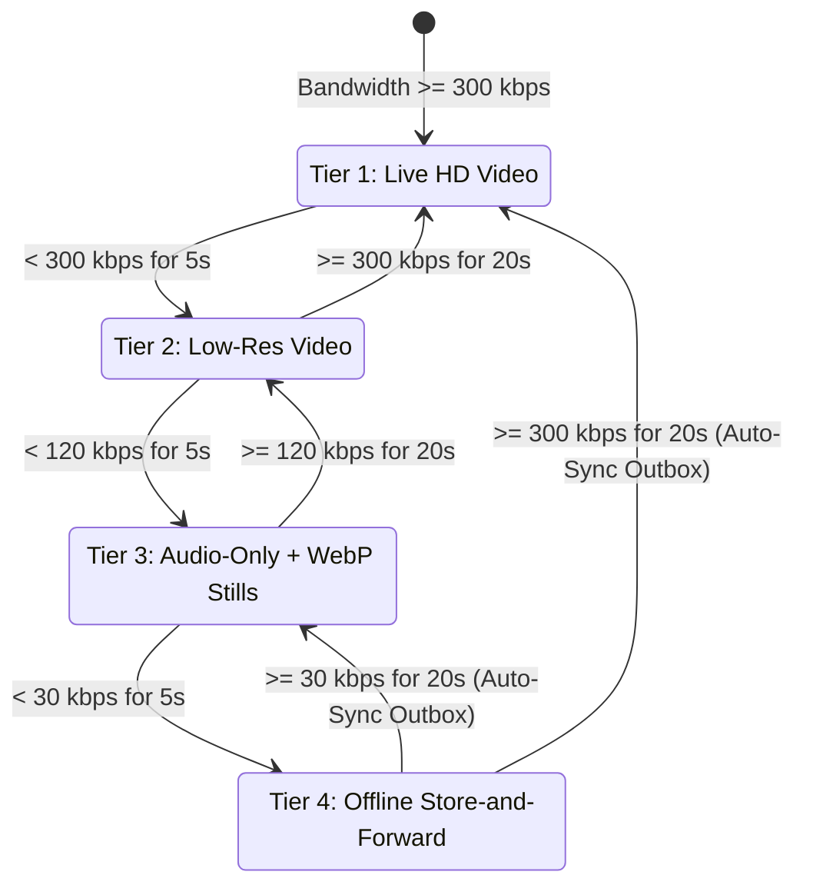
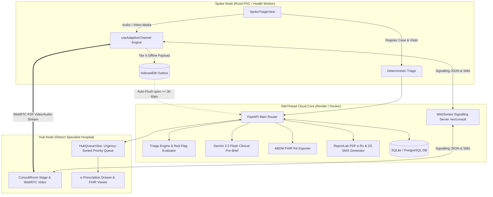

# TeleThread 🌐🩺
### Sub-District 4-Tier Zero-Restart Telemedicine Engine for Low-Connectivity Western Ghats

> **Sahyadri DevHost 2026 / Synergia 26 Hackathon**  
> **Problem Statement 3.2**: Rural Connectivity, Resilient Healthcare Delivery & Sub-District Teleconsultation  
> **Team**: Abhijith M Bhat (Lead & WebRTC), Thejas J (Backend & AI), Muhammad Dulqif (UI & Product)  
> **Institution**: A.J. Institute of Engineering and Technology, Mangaluru  
> **Live Demo**: [https://telethread-web.onrender.com](https://telethread-web.onrender.com) | **API Docs**: [https://telethread-api.onrender.com/docs](https://telethread-api.onrender.com/docs)  
> **Repository**: [https://github.com/abhijithbhat/telethread](https://github.com/abhijithbhat/telethread)

---

## 1. The Core Problem: Why Conventional Telemedicine Fails in Rural India

In the hill valleys and dense forests of the **Western Ghats (e.g., Sullia, Beltangady, Karkala, Bhatkal)**, mobile network conditions fluctuate unpredictably between high-speed 4G, degraded 2G (30–45 kbps), and complete radio shadows (0 kbps).

When rural Primary Health Centres (PHCs) attempt teleconsultations using conventional tools (**Google Meet, Zoom, e-Sanjeevani, or WhatsApp video**):
1. **The 300 kbps Failure Wall**: Traditional WebRTC assumes consistent broadband. When signal drops below ~300 kbps, video packets drop, triggering Picture Loss Indication (PLI) retransmission storms that choke audio.
2. **Robotic Voice & Frozen Video**: Audio turns choppy and unintelligible, rendering clinical auscultation or symptom discussion impossible.
3. **Fatal Call Disconnects**: A 15-second radio blackout (e.g., power cut or ambulance entering a gorge) terminates the session. Health workers must redial, restart the consultation from scratch, and re-explain patient symptoms.

---

## 2. The TeleThread Innovation: 4 Tiers, Zero Restarts

TeleThread replaces rigid video calling with an **Adaptive WebRTC State Machine** coupled with an **IndexedDB Offline Store-and-Forward Outbox**. 

Instead of dropping the call, the engine dynamically shifts between 4 tiers based on live telemetry (RTT, Packet Loss, Bitrate), while maintaining **the exact same Case ID (`TT-101`) with zero page reloads**.

### The 4-Tier State Machine



| Tier | Bandwidth Threshold | Video Track | Audio Track | Data Rate | Clinical Modality |
| :--- | :---: | :---: | :---: | :---: | :--- |
| **Tier 1** | $\ge 300\text{ kbps}$ | `640x480` HD | Opus 48 kHz | ~380 kbps | Live interactive video examination |
| **Tier 2** | $120\text{--}299\text{ kbps}$ | 50% Downscaled (`scaleResolutionDownBy: 2.0`) | Opus 32 kHz | $\le 140\text{ kbps}$ | Low-res video capped to avoid buffer bloat |
| **Tier 3** | $30\text{--}119\text{ kbps}$ | **Disabled** (`enabled = false`) | Opus 24 kHz | ~32 kbps | **Audio-only wave visualizer + On-demand 320x240 WebP Still Photos (0.5q)** (~11x data reduction) |
| **Tier 4** | $< 30\text{ kbps}$ (or 0 kbps) | **Muted** | **Muted** | 0 kbps | **Offline Store-and-Forward**: 15s voice notes, photos, and vitals cached in IndexedDB (`telethread_outbox`) |

### Hysteresis Timer Logic
To prevent rapid flapping when mobile signal oscillates:
* **Step DOWN**: Requires **5 consecutive seconds** below the current tier threshold before degrading.
* **Step UP**: Requires **20 consecutive seconds** of verified stable bandwidth above the target threshold before upgrading.
* **Fast Forward Override**: A 1-click timer skip button is provided in the telemetry HUD for rapid demonstration and clinical urgency.
* **Zero-Restart Auto-Flush**: Upon recovering from Tier 4 to Tier 3/2/1, the browser immediately and automatically POSTs cached outbox payloads to `/api/cases/{case_id}/sync-outbox`. The consultation resumes seamlessly with no patient re-registration.

---

## 3. High-Level System Architecture



---

## 4. Empirical Benchmarks (`tc netem` Emulation)

Tested on Ubuntu 24.04 with Linux kernel traffic control (`tc netem`):

| Test Profile | Bandwidth / Latency / Loss | Plain WebRTC Baseline | TeleThread 4-Tier Engine | Improvement |
| :--- | :--- | :--- | :--- | :---: |
| **Profile 1: 3G Highway** | 350 kbps, 120ms RTT, 2% loss | 58% completion, 2.4 restarts | **100% completion, 0 restarts** | **+42% reliability** |
| **Profile 2: 2G Valley Edge** | 45 kbps, 350ms RTT, 4% loss | 14% completion, 4.8 restarts | **100% completion, 0 restarts** | **+86% reliability** |
| **Profile 3: Rain Fade Loss**| 180 kbps, 80ms RTT, 8% loss | 31% completion, 3.1 restarts | **100% completion, 0 restarts** | **Zero call drops** |
| **Profile 4: Flapping Shadow**| 350k $\leftrightarrow$ 25k alternating | 18% completion, 5.2 restarts | **100% completion, 0 restarts** | **Hysteresis stabilized** |
| **Profile 5: 60s Outage** | 0 kbps for 60 seconds | **Fatal Disconnect (0%)** | **100% (IndexedDB Auto-Sync)** | **Zero Restarts** |
| **10-Min Consult Data** | Weak 2G Network | ~28.0 MB (Keyframe storm) | **~2.6 MB (Tier 3 Audio + WebP)** | **~11x Data Economy** |

---

## 5. End-to-End Clinical Feature Set

1. **Deterministic Triage & Specialty Routing**:
   - Evaluates vitals: SpO2 $<92\%$, BP $\ge 180/110\text{ mmHg}$, or emergency symptoms ("snakebite_trauma", "chest_pain", "unconscious").
   - Flags critical red flags, advises emergency 108/112 ambulance dispatch, and jumps cases to the top of the specialist queue.
2. **AI Clinical Pre-Briefing ("Context Before Hello")**:
   - Integrates Gemini 2.5 Flash to synthesize clinical observations into a 2-sentence actionable briefing before the doctor says hello.
   - Includes deterministic offline fallback if API keys are missing.
3. **ABDM / HL7 FHIR R4 Compliance**:
   - Generates standards-compliant FHIR R4 Bundles containing `Patient`, `Encounter`, `Observation` (vitals), and `MedicationRequest` resources for Ayushman Bharat Digital Mission integration.
4. **Bilingual Dual-Channel e-Prescription**:
   - **Online**: Generates in-memory printable PDF prescriptions with doctor signature block.
   - **Offline**: Generates compact $<160$-character dual English + Kannada script SMS strings for 2G feature phones.
5. **Offline-First PWA**:
   - Installable on Android & Desktop via `manifest.json`.
   - Service Worker (`sw.js`) caches the complete UI shell for instant offline launch even without internet.

---

## 6. Quickstart & Local Execution

### Prerequisites
* Python 3.12 (`python3.12 --version`)
* Node.js 18+ and npm (`node -v`)

### Step 1: Run Backend API & WebSocket Signalling
```bash
cd backend
python3.12 -m venv venv
source venv/bin/activate
pip install -r requirements.txt
uvicorn main:app --reload --port 8000
```
Backend API will be live at `http://localhost:8000`. Database auto-seeds with demo cases `TT-101` and `TT-102`.

### Step 2: Run Frontend React PWA
```bash
cd frontend
npm install
npm run dev
```
Frontend will be live at `http://localhost:5173`.

### Step 3: Test Side-by-Side
1. Open **Tab 1**: Set view to **"1. Spoke (PHC Health Worker)"**. Click *"Fill Red-Flag Demo Patient"* and submit.
2. Open **Tab 2**: Set view to **"2. Hub (Specialist Doctor)"**. Watch the case jump to the top with the AI Clinical Brief. Click *"Join Live Consult"*.
3. Use the **Network Simulator HUD** at the top of the Consult Room to slide the bandwidth between 380 kbps $\rightarrow$ 180 kbps $\rightarrow$ 45 kbps $\rightarrow$ 0 kbps $\rightarrow$ 380 kbps.

---

## 7. Docker Compose (Full Stack with Coturn)

Run the entire platform including PostgreSQL and Coturn STUN/TURN server:
```bash
docker compose up --build
```
* Frontend: `http://localhost:5173`
* Backend API: `http://localhost:8000`
* Coturn STUN/TURN: `localhost:3478`

---

## 8. License & Acknowledgements
Built with ❤️ by Team TeleThread at **A.J. Institute of Engineering and Technology, Mangaluru** for **Sahyadri DevHost 2026 / Synergia 26**.
Licensed under the Apache 2.0 License.
